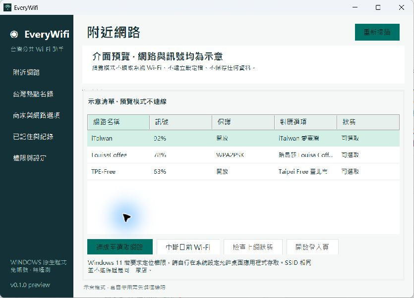

# EveryWifi

輕量 Windows 台灣公共 Wi-Fi 助手。使用原生 WinForms 與 Windows WLAN API，在右下角通知區域常駐，讓你看清楚連線狀態、選擇公開網路、自己決定權限。

[Landing page](https://everywifi.pages.dev/) · [Windows 下載](https://github.com/AriesHongHuanWu/EveryWifi/releases/tag/v0.1.0) · [資料來源](docs/NETWORK_SOURCES.md)



## 安裝與使用

1. 從 Releases 下載 `EveryWifi-Windows.zip`，解壓縮整個資料夾。
2. 在 Windows 10/11 開啟 `EveryWifi.exe`。需要 .NET Framework 4.8（現代 Windows 通常已內建）；不需要 WebView2、Node、管理員或安裝服務。
3. 第一次開啟選擇掃描、記住密碼、上網檢查權限。全都不勾選仍可瀏覽內建名錄。
4. 掃描後選擇實際出現的網路，確認你有使用權，再按連線。路易莎先搜尋實際所在門市，只提交你選擇的一組密碼。
5. 「已連上 Wi-Fi」只代表無線連線成功。按「檢查上網狀態」查看網際網路是否可用；需要登入時按「開啟登入頁」，自行完成條款或驗證。

關閉視窗會收至右下角；雙擊圖示再次開啟，右鍵可掃描、看設定或結束。登入時執行與自動連線均需自行開啟。

Windows 11 新版可能需要在「設定 → 隱私權與安全性 → 位置」允許定位與桌面應用程式存取，Windows 才提供附近 SSID/BSSID。本程式不自動修改隱私設定，也不讀取 GPS。

## 收錄與連線能力

資料快照：2026-10-13。收錄 **14,695 個不重複官方 iTaiwan 熱點位置、22 縣市、519 家路易莎門市與 23 個服務選項**。23 個選項包含 14 個有官方 SSID 的入口服務、路易莎及 8 個需現場確認的指引。

- iTaiwan、TPE-Free、NewTaipei、iTaoyuan、iTaichung、Tainan、台灣高鐵、指定機場與 Starbucks 等官方選項。
- 熱點名錄沒有逐點 SSID/BSSID，不代表每個點在現場都有訊號或持續可用；必須掃描實際網路。
- 原專案提供 519 家路易莎電話資料與候選密碼規則，並非官方保證的 Wi-Fi 密碼。不會輪流嘗試附近門市或批次猜測。
- 手動指引不假造通用密碼。收錄商家不代表每家分店提供 Wi-Fi，請以現場公告與店員提供資訊為準。
- 可連線到掃描到的開放、WPA2-Personal/AES 或系統支援的 WPA3-Personal/AES 網路；企業認證、WEP、舊 WPA、隱藏 SSID 請使用 Windows 原生介面。
- 可匯入自訂公開網路 JSON（每檔最多 200 個選項），或直接輸入你有權使用的店家密碼。匯入本身不會觸發連線。

## 權限、資料與防毒

所有選項預設關閉。自動連線需同時允許掃描與儲存，且只回到成功記住的同一 SSID/BSSID/安全模式。已有 Wi-Fi 連線時保留現有連線；失敗後至少等待 5 分鐘。同名 SSID 或 BSSID 仍可能被冒用，請確認場地網路。

一般使用者 `asInvoker`，不申請 UAC，不裝驅動、服務或排程，不加入防毒排除，不下載或執行更新。沒有帳號、分析追蹤或遙測；內建資料可以離線查閱。

使用者同意儲存後，成功記住的密碼以 Windows DPAPI 綁定目前帳號加密保存於 `%LOCALAPPDATA%\EveryWifi\saved-networks.dat`。設定與最多 100 筆不含密碼的連線紀錄存放同一資料夾。使用者自己匯入的「公開網路」目錄是普通 JSON，請勿將私人或機密憑證放入其中。

連線由 Windows WLAN 管理；要求連線時會建立 `EveryWifi-` 前綴的手動、目前使用者設定檔，Windows 也會保存金鑰。已記住頁面或設定中的清除功能可移除本程式建立的設定檔。撤銷儲存權限會停止讀取與新增紀錄，既有加密檔需由使用者清除。

只有允許上網檢查後，按下按鈕才向 `http://www.msftconnecttest.com/connecttest.txt` 發出短 HTTP 請求；這有助辨識 captive portal，不傳送密碼。登入頁僅由使用者明確點擊開啟，本程式不收集或自動填入帳密、電話、OTP，不略過付費與使用條款。

**v0.1.0 是未簽章預覽版**。SmartScreen 可能提示未知發行者；權限確認本身不會替程式取得簽章或防毒信譽。請核对 Releases 的 SHA-256，必要時請系統管理員審閱原始碼；不要關閉 Defender 或加入防毒排除。正式發行需可信憑證／Microsoft Artifact Signing 與持續建立發行信譽。本專案不聲稱零誤判。

## 開發與驗證

Windows + .NET SDK 8 或更新版本：

```powershell
./scripts/build.ps1
```

輸出在 `artifacts/EveryWifi-Windows.zip`，同時產生 SHA256SUMS.txt 與 landing page 下載檔。測試只處理 profile XML、密碼／網址驗證及資料結構，不切換開發者實際 Wi-Fi。

`EveryWifi.exe --preview` 提供明確標示的示意介面，不存取系統 Wi-Fi 或儲存本機設定。

已完成本機與 GitHub Windows 建置、78 項檢查、原生視窗預覽與網站桌面／手機檢查。尚未在各商家現場測試連線或 WPA3/captive portal，也尚未取得可信程式碼簽章。詳細紀錄見 [驗證範圍](docs/VERIFICATION.md)。

```powershell
./scripts/refresh-hotspots.ps1
```

上述指令明確執行時才擷取官方熱點並更新快照。本程式不在背景自動下載社群密碼。Cloudflare Pages 部署設定見 [docs/DEPLOYMENT.md](docs/DEPLOYMENT.md)。

## 授權與來源

程式碼 MIT。EveryWifi 的 Windows 程式重新實作，沿用 [madeyexz/louisa-wifi](https://github.com/madeyexz/louisa-wifi/) 的資料與想法，保留 Ian Hsiao 的 MIT 授權。政府資料依政府資料開放授權條款；詳見 [來源與授權](docs/NETWORK_SOURCES.md)。本專案與各商家沒有官方合作或背書。
